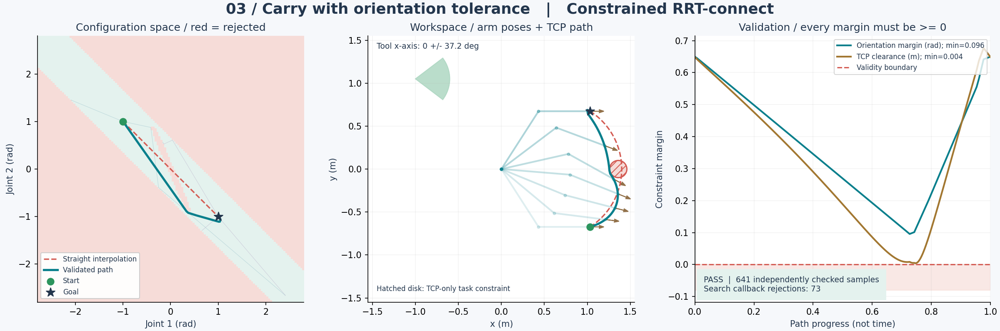
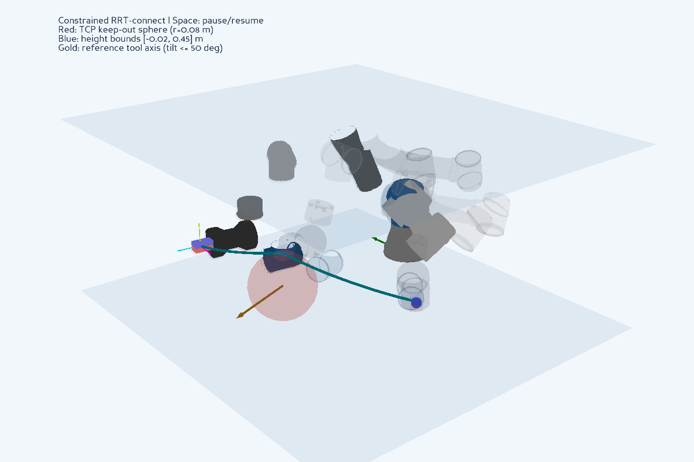

# 带 callback 任务约束的 RRT-connect

`ConstrainedRRTConnect` 继承 WRS 的 `RRTConnect`，放在主仓库
`gomp/planner/constrained_rrt_connect.py`，不修改 WRS 的 RRT/RRTConnect 实现。
保留原来的关节限位、自碰撞和场景碰撞检测，再通过 callback 增加任务约束。
成功返回 WRS `MotionData`，失败返回 `None`。

## 最小接入方式

在仓库根目录运行下面的代码。机器人使用完整的 WRS `RobotInterface`
（例如 `UR3e_RtqHE`、`UR7EDh50`），与原 `RRTConnect` 一致。

```python
import numpy as np
import gomp  # 注册仓库中的 WRS 导入路径
from gomp.planner import ConstrainedRRTConnect
from wrs.robot_sim.robots.ur3e_dual.ur3e_rtqhe import UR3e_RtqHE

robot = UR3e_RtqHE(enable_cc=True)

def task_constraint(robot, q):
    # True = 允许，False = 拒绝。q 的单位为 rad。
    # 调用前已经完成 FK，可以直接读取当前末端位置/朝向。
    joint_ok = -1.0 <= q[0] <= 1.0
    height_ok = robot.gl_tcp_pos[2] >= 0.05
    return bool(joint_ok and height_ok)

planner = ConstrainedRRTConnect(
    robot, constraint_fn=task_constraint, check_resolution=0.02)
start = np.array([-0.5, -0.8, 1.2, -0.4, 1.2, 0.0])
goal = np.array([0.5, -0.8, 1.2, -0.4, 1.2, 0.0])
motion = planner.plan(start, goal, ext_dist=0.2,
                      max_time=30, smoothing_n_iter=150,
                      toggle_mesh=False)
if motion is not None:
    print(np.asarray(motion.jv_list))
```

多个约束可以组合：

```python
def combined(robot, q):
    return all(check(robot, q) for check in (joint_limit, tcp_height, tool_axis))
```

callback 必须返回 `bool` 或 `numpy.bool_`，不能返回数组、`None` 或数值；
必须保持确定性，不修改机器人状态。传入的 `q` 是只读副本。
callback 抛出的异常会原样传出，规划器用 `try/finally` 恢复机器人状态。

## 运行示例

先按照主 README 安装依赖并初始化 WRS 子模块：

```bash
git submodule update --init --recursive
pip install -e .
```

本次子模块引用包含 STL 读取器的 NumPy 标量兼容修复；请同步子模块引用，
避免使用旧版 WRS 在新 NumPy 下加载机器人网格时报错。

### 二连杆：三种约束

```bash
# 打开三个窗口，播放机器人运动
python examples/constrained_rrt_connect.py

# 不打开窗口，同时导出 PNG、GIF、NPZ
python examples/constrained_rrt_connect.py --headless --gif

# 单独运行姿态 + 禁区组合约束
python examples/constrained_rrt_connect.py --scenario orientation
```

| 场景 | callback 内容 | 可视化内容 |
|---|---|---|
| `joint_window` | 比硬件限位更严格的关节角窗口 | 关节空间允许/拒绝区域、最小关节余量 |
| `tcp_keepout` | 末端不能进入指定圆形区域 | TCP 禁区、直线插值对照、绕行后的末端路径 |
| `orientation` | 工具 x 轴方向保持在 ±0.65 rad，同时避开 TCP 禁区 | 姿态扇形、工具方向箭头、姿态与净空余量 |

每张图同时展示：关节空间约束和两棵搜索树、机器人工作空间、最终路径的约束余量。
绿色是起点，深色星形是终点，青色是规划结果，红色虚线是直接关节插值的对照。
禁区仅约束 TCP，不代表整根连杆都要避开该区域；物理障碍仍由原碰撞检测处理。



### WRS UR3e：六轴机械臂

```bash
# 直接打开 WRS Panda3D：真实机器人、约束区域、最终路径和实时回放
python examples/constrained_rrt_connect_wrs.py
```

UR3e 示例组合了 TCP 球形禁区、高度区间和工具 z 轴方向容差。
方向容差是相对于示例参考姿态的 **50° 圆锥范围**，工具绕自身 z 轴的旋转是自由的；
它不是完整姿态锁定。WRS 自碰撞检测保持开启。
Panda3D 窗口中空格暂停/继续，鼠标操作沿用 WRS 的视角控制。
红色球体表示 TCP 禁区，蓝色平面表示高度上下界，金色箭头表示工具参考方向，
青色曲线表示最终 TCP 路径，绿色/蓝色小球分别标记起点/终点。
脚本按“约束回调 → 规划 → 路径复核 → Panda3D 回放”展开，固定使用种子 `7`；
可以直接在 `main()` 中修改起终点和约束参数。此示例不生成图片、GIF 或数值文件。



二连杆脚本默认使用随机种子 `7`，支持 `--seed` 和 `--output-dir`。
其文件默认输出到 `artifacts/constrained_rrt/`（已加入 `.gitignore`）：

- `*.png`：约束区域、最终结果和余量图。
- `*.gif`：加上 `--gif` 时导出机器人运动和同步进度指示。
- `*.npz`：路径及复核数据，方便通过 `numpy.load(...)` 继续分析。

图中的进度表示路径进度，不是执行时间；本示例没有做速度/加速度参数化。
默认种子的三个二维场景和 UR3e 场景均在显示结果前以 **0.005 rad** 的更细步长独立复核。
复核包括插值段；UR3e 还重新执行 WRS 碰撞检测。复核失败会报错，不会输出成功结论。

## 为什么不能只在 `_is_collided` 里加一行 callback

单独覆盖采样点检测可能遗漏距离小于 `ext_dist` 的起终点直连、两棵树之间的连接边、
以及平滑后新产生的线段。本实现会对这些线段一并采样检查：

1. 扩展和快捷平滑都精确包含终点，不越过目标点。
2. 验证采样间距不超过 `min(ext_dist, check_resolution)`；树连接边按 `check_resolution` 验证。
3. 任意一棵树首先连接成功时立即组装路径，避免重复使用 WRS 的 `connection` 节点。
4. 验证、搜索失败或 callback 抛出异常时均恢复原机器人状态。

`check_resolution` 是关节向量的欧氏距离阈值，不是 TCP 的米制距离。
混合移动/转动关节需要根据单位和具体机器人选择合适的分辨率。
这仍是**离散采样检查**，不能证明任意小的禁区都不会被跨越。
更窄的禁区需要更小的步长，实际任务也应给约束留出余量。
输出段使用线性关节插值；后续做样条平滑或轨迹优化，必须重新验证新轨迹。

这是拒绝采样型约束规划，适合不等式或带容差的任务约束。
“高度必须精确等于某个值”“姿态完全不动”等零厚度等式约束，通常需要投影式
constrained planning；不要直接用 `==` callback 期待随机采样能有效搜索。

`toggle_mesh=False` 适合无抓持物的无窗口计算；默认 `True` 使用 WRS 的网格及抓持物记录。
`max_time` 沿用 WRS 搜索时间限制的含义，不包括后续平滑、网格构建和可视化时间。

## 测试

```bash
python -m unittest discover -s tests -p test_constrained_rrt_connect.py -v
```

覆盖非法端点、薄约束区域、物理碰撞、树连接、快捷平滑、callback 的 FK/布尔契约、
异常恢复及多次调用。也可以使用项目的 pytest 开发依赖运行同一测试文件。
